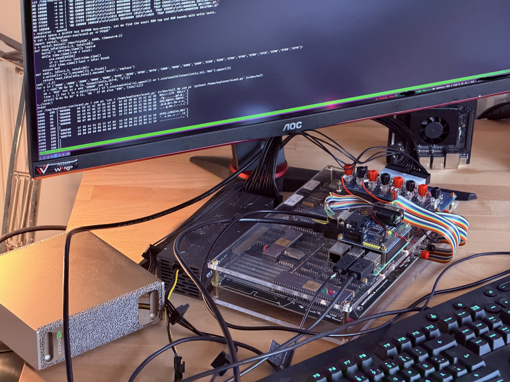
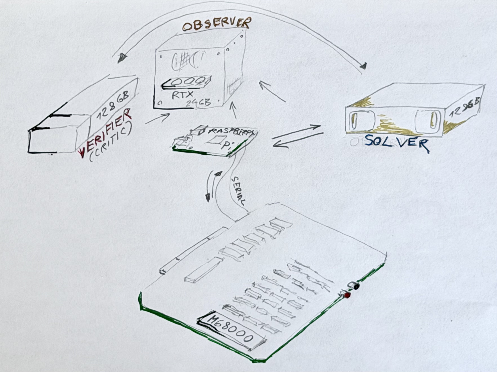

# explorer-of-serial


**Local AI agents, with only local LLMs, investigate an unknown machine attached to a serial port.**
It doesn't have Internet access, does not have access to the device's documentation. There's no human to help. 
Just two local LLMs, an SSH session into a Raspberry Pi, and that unknown device.



## The experiment

I wired an anonymous device — “X” — to a Raspberry Pi's serial port, told an
LLM agent: *find out what X is, reverse-engineer its protocol, and run your own
program on it*, and walked away. The agent ran inside a network jail (no
way out except two model servers and the Pi), and every claim it made had to be
verified, based on evidence by a **second, independent LLM** with fresh context
on another box. 

**It worked.** In ~5.5 hours, `Qwen3.8-Flash-Next` (on a DGX Spark) discovered
that X was a **Motorola 68000 single-board trainer running “TUTOR 1.3”**. It
first suspected the machine was KIM-1 with a similar ROM, but later corrected the course. It mapped X's memory by
*deliberately triggering bus errors*, decoded its monitor's command set
line-by-line, assembled and ran its own program on 68000 hardware, and wrote a
verdict the critic accepted — [`RESULT.md`](runs/2026-11-19-68000-trainer/RESULT.md).
Then, probing one I/O corner too deep, it **hung X's CPU**. Which was not a problem at that point,
as all the goals had been by then achieved. 



## How it works

Both roles are [OpenCode](https://opencode.ai) agents, driven headlessly by
[`go.sh`](go.sh) via `opencode run`; OpenCode's permission layer is also the
first jail layer.

- **Solver** — the [`explorer`](.opencode/agents/explorer.md) agent: plans,
  SSHes into the Pi, pokes the serial line, keeps a durable notes file
  (`FINDINGS.md`) that survives context compactions over a 12-hour run.
- **Critic** — the [`verifier`](.opencode/agents/verifier.md) subagent on a
  second model server: adversarial final gate, ≤3 rounds, grades file
  pointers + evidence chains, vetoes unsupported claims. It rejected and
  forced fixes along the way.
- **Jail** — systemd network sandbox (`IPAddressDeny=any` + allowlist) with a
  hard `netcheck` gate: if the jail leaks, the run refuses to start. The rules
  are also in the prompt — and the agent never tried to escape either. Details: [`docs/JAIL.md`](docs/JAIL.md).
- **Ground rules** — [`AGENTS.md`](AGENTS.md) (protocol) + [`task.md`](task.md)
  (mission): read evidence or perish; “I don't know, and here's how to revive
  it” beats a confident fabrication.

## What's in the box

Three full runs are published under [`runs/`](runs/) — the headline run first.
Each one holds `RESULT.md` (the verdict), `FINDINGS.md` (the working notebook)
and the
**raw console logs** — full transcripts, nothing summarised, only home-network
details mechanically renamed:

- [`runs/2026-11-19-68000-trainer/`](runs/2026-11-19-68000-trainer/) — the run
  described above (`Qwen3.8-Flash-Next`, 87 turns): the task won, the 8-step
  `evidence/` chain included; the final gate rejected it once on citation gaps
  and approved at round 2.
- [`runs/2026-11-20-68000-deep-dive/`](runs/2026-11-20-68000-deep-dive/) — the
  same machine re-examined against every byte of a new raw transcript; the
  critic only signed off at round 3, having caught two rounds of over-claims,
  and recorded "no new findings" — verification, not rediscovery.
- [`runs/2026-11-17-first-contact/`](runs/2026-11-17-first-contact/) — the
  very first end-to-end completion: ~39 hours over 8 resumes,
  and the one that first pinned X as a 68000-family system running TUTOR.
- The harness: [`go.sh`](go.sh) (run entry), [`scripts/`](scripts/) (jail,
  lifecycle, citation auditor, live console watcher), [`config/`](config/).

## Replay it

Requires the [OpenCode](https://opencode.ai) CLI, two OpenAI-compatible model
servers (e.g. llama.cpp's `llama-server`), and a Linux box with
systemd-networkd if you want the jail. Local weights only — bring your own
endpoints:

```
cp config/explorer.example.json config/explorer.$(id -un).json   # point at your model servers
cp .env.example .env                                              # point at your target
sudo scripts/install-jail.sh                                      # optional: enable the jail
TASK_FILE=task.md ./go.sh
scripts/commentate.py --web --db                                  # narrate it live on a page
```

Full lifecycle docs: [`HOW_TO_RUN.md`](HOW_TO_RUN.md).

*No devices were permanently harmed. X just needs someone to pull its plug —
the one thing the agent wasn't allowed to do.*

MIT licensed. Write-ups and logs included.
